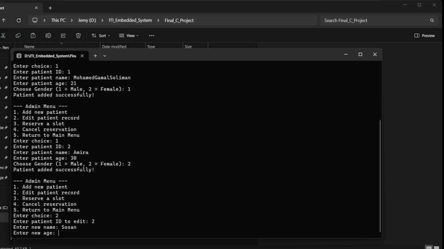

# Clinic Management System

A menu-driven C console application for maintaining a small clinic's patient list and appointment schedule.

## Features

- Admin mode protected by a source-defined password and limited login attempts.
- Add and edit patient records containing an ID, name, age, and gender.
- Reserve and cancel one of five fixed appointment slots per patient.
- User mode for viewing patient records and the day's reservations.
- In-memory storage for up to 20 patients; data is not persisted after the program exits.

## Build and run

No embedded hardware is required; the program runs in a terminal and requires a C compiler such as GCC. From this directory:

```sh
gcc Clinic_Management_System.c -o clinic-management
./clinic-management
```

On Windows, run `clinic-management.exe` after compiling. The admin password is `1234` in the current source; change `PASSWORD` in the source before using the program outside a demonstration.

## Media



Original recording retained locally in the ignored `local_original_videos/` folder.
