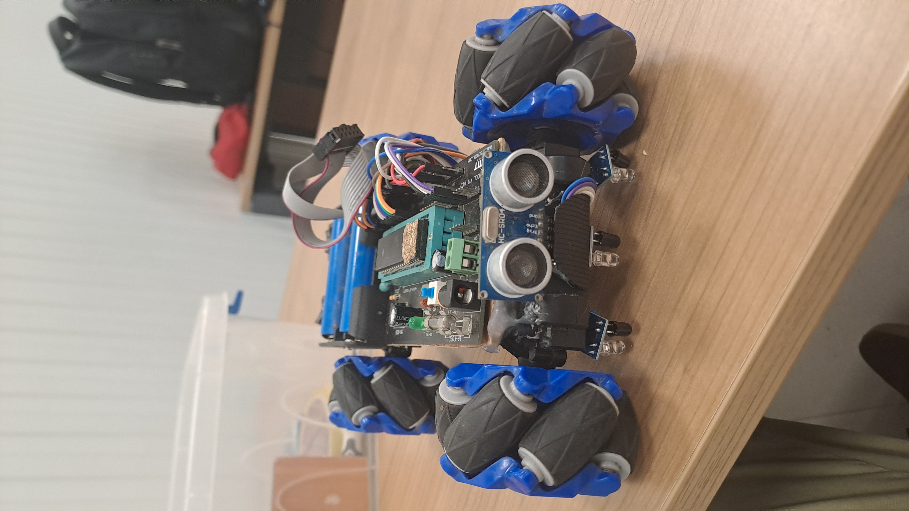
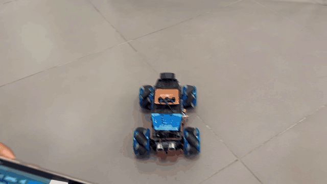
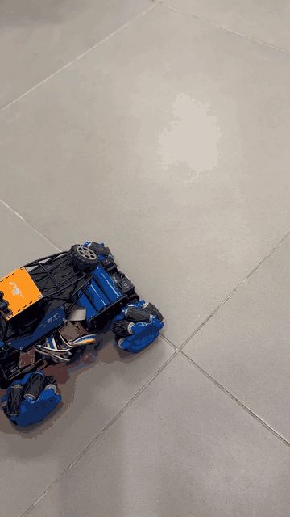

# Final RC Car Project

ATmega32-oriented firmware for a four-motor RC car with Bluetooth-controlled and ultrasonic obstacle-avoidance modes.

## Functionality

- **Autonomous mode:** reads an ultrasonic distance; drives forward when the path is clear, then compares left and right distances and turns toward the clearer path when an obstacle is near.
- **Bluetooth mode:** receives single-character movement commands over the HC-05 serial link, including forward, reverse, turns, and stop. Separate commands switch the onboard LED and buzzer.
- Two selector inputs choose autonomous or Bluetooth operation. The firmware stops all motors when neither mode is selected; autonomous mode is checked first when both inputs are active.

## Hardware and software setup

- Firmware is under [`firmware/`](firmware/). The custom Bluetooth, DC motor, and ultrasonic modules are included.
- The code uses shared AVR definitions and DIO/USART interfaces from the separately published [`AVR-ATmega32-Layered-Drivers`](https://github.com/MohamedGamal045/AVR-ATmega32-Layered-Drivers). Add the required library headers and source files to the AVR-GCC/AVR Eclipse project when building.
- Configure the target MCU and clock to match the board. The HC-05 is configured for 9600 baud.
- The source maps the four motor channels to PA0-PA7, ultrasonic trigger/echo to PD2/PD3, status LED/buzzer to PD6/PD7, and mode selectors to PB0/PB1. Connect the motors through a suitable external motor driver and provide an appropriate motor supply; do not drive motors directly from MCU pins.
- Confirm pin mappings, logic levels, motor polarity, and power wiring against the actual hardware before applying power. No schematic file is included in this project folder.

## Media

**Bluetooth-controlled driving**

**RC car motion highlight**

Original recordings are retained locally in the ignored `local_original_videos/` folder.

- [All project photos](media/photos/)
