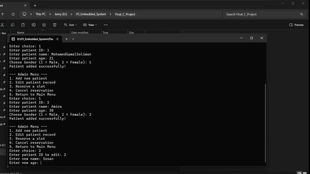
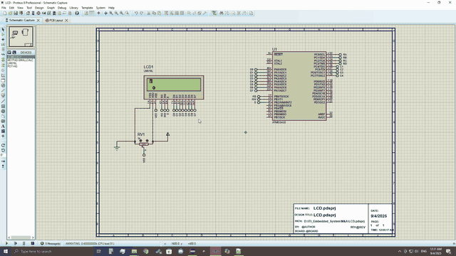
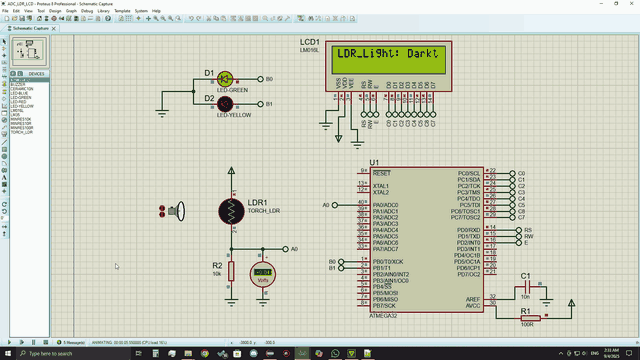
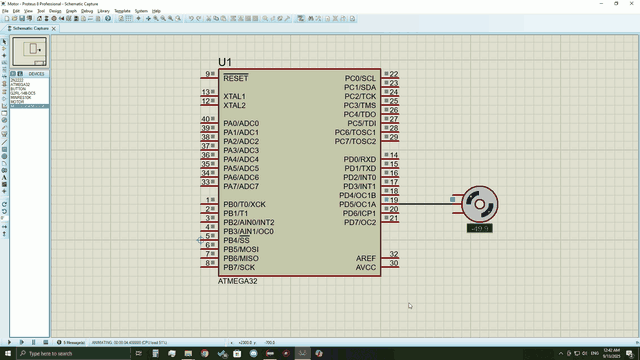
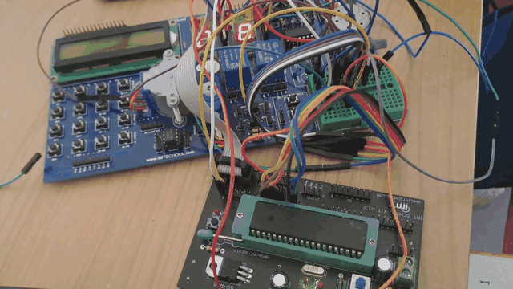
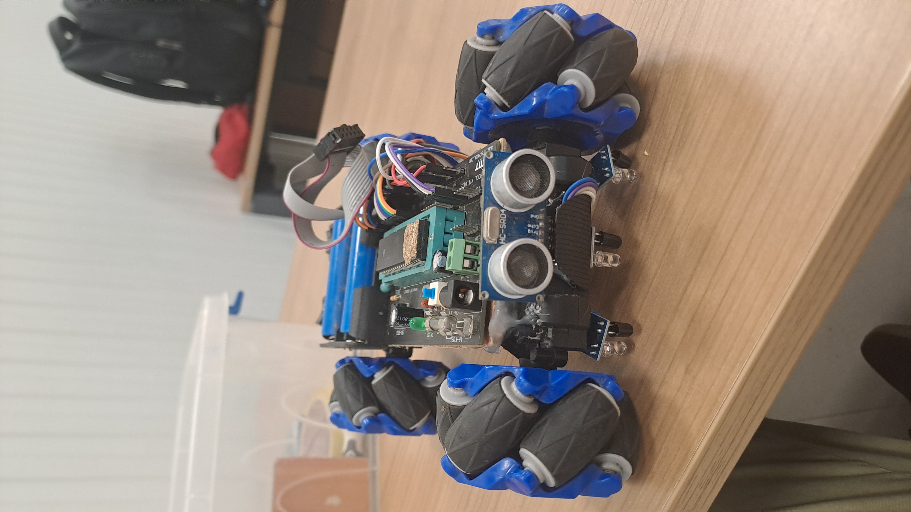
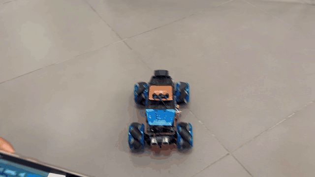
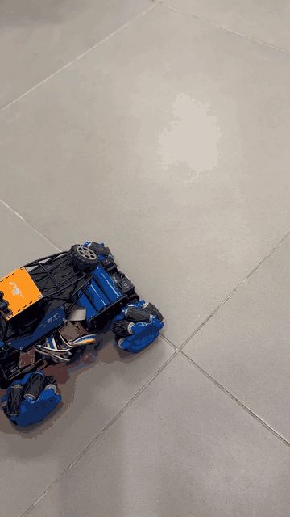

# ITI AVR ATmega32 Embedded Applications

This repository brings together the practical applications, C programming work, hardware-interfacing labs, Proteus simulations, and final RC car project completed during the ITI Embedded Systems diploma.

The `MG_AVR_Atmega32` layered driver library has already been published separately in [`AVR-ATmega32-Layered-Drivers`](https://github.com/MohamedGamal045/AVR-ATmega32-Layered-Drivers). It is intentionally not duplicated here; projects that use the shared drivers should refer to that repository.

> **Media:** Original recordings are preserved locally in the ignored `local_original_videos/` folder and are not published. Selected short GIF previews are included below for fast-loading project demos.

## Repository map

| Section | Contents | Folder |
| --- | --- | --- |
| C programming | Clinic Management System and 13 console exercises covering operators, control flow, arrays, factorial-based permutations/combinations, and linked lists | [`01_C_Programming/`](01_C_Programming/) |
| AVR interfacing and labs | 15 AVR peripheral demonstrations plus 9 C/algorithm labs, with source, IDE files, screenshots, and demos | [`02_AVR_Interfacing_and_Labs/`](02_AVR_Interfacing_and_Labs/) |
| Proteus simulations | 19 Proteus projects for ADC, LCD, LED, motor, keypad, seven-segment, stepper, relay, and UART exercises | [`03_Proteus_Simulations/`](03_Proteus_Simulations/) |
| Final RC car | ATmega32-oriented firmware for Bluetooth/manual and ultrasonic/autonomous driving, plus project photos and videos | [`04_Final_RC_Car_Project/`](04_Final_RC_Car_Project/) |
| AI-powered drone | Aerial image detection, transmitter/receiver control, IoT monitoring, PCB hardware, mechatronics development, and Launch Exhibition recognition | [`05_AI_Powered_Drone_Project/`](05_AI_Powered_Drone_Project/) |

## C programming projects

| Project | Concepts | Folder | Screenshots / demo |
| --- | --- | --- | --- |
| Clinic Management System | Patient records, admin/user menus, appointment reservation and cancellation | [Project](01_C_Programming/Clinic_Management_System/) | [GIF preview](01_C_Programming/Clinic_Management_System/media/clinic_management_demo.gif) |
| Star Pyramid | Console output and nested patterns | [Project](01_C_Programming/Exercises/Star_Pyramid/) | [Source](01_C_Programming/Exercises/Star_Pyramid/media/source.png) · [Output](01_C_Programming/Exercises/Star_Pyramid/media/output.png) |
| Reverse Three Numbers | Input and reverse-order output | [Project](01_C_Programming/Exercises/Reverse_Three_Numbers/) | [Source](01_C_Programming/Exercises/Reverse_Three_Numbers/media/source.png) · [Output](01_C_Programming/Exercises/Reverse_Three_Numbers/media/output.png) |
| Arithmetic and Bitwise Operators | Integer arithmetic and bitwise AND/OR/XOR | [Project](01_C_Programming/Exercises/Arithmetic_and_Bitwise_Operators/) | [Source](01_C_Programming/Exercises/Arithmetic_and_Bitwise_Operators/media/source.png) · [Output](01_C_Programming/Exercises/Arithmetic_and_Bitwise_Operators/media/output.png) |
| ASCII Staircase | Console formatting | [Project](01_C_Programming/Exercises/ASCII_Staircase/) | [Source](01_C_Programming/Exercises/ASCII_Staircase/media/source.png) · [Output](01_C_Programming/Exercises/ASCII_Staircase/media/output.png) |
| Largest of Three Numbers | Conditional comparisons | [Project](01_C_Programming/Exercises/Largest_of_Three_Numbers/) | [Screenshot](01_C_Programming/Exercises/Largest_of_Three_Numbers/media/screenshot.png) |
| Command-Line Calculator | Switch/case arithmetic and divide-by-zero handling | [Project](01_C_Programming/Exercises/Command_Line_Calculator/) | [Screenshot](01_C_Programming/Exercises/Command_Line_Calculator/media/screenshot.png) |
| Multiplication Quiz | Input validation and conditions | [Project](01_C_Programming/Exercises/Multiplication_Quiz/) | [Screenshot](01_C_Programming/Exercises/Multiplication_Quiz/media/screenshot.png) |
| Multiplication Table | Iteration and formatted output | [Project](01_C_Programming/Exercises/Multiplication_Table/) | [Screenshot](01_C_Programming/Exercises/Multiplication_Table/media/screenshot.png) |
| Permutations (nPr) | Factorial and combinatorics | [Project](01_C_Programming/Exercises/Permutations_nPr/) | [Screenshot](01_C_Programming/Exercises/Permutations_nPr/media/screenshot.png) |
| Combinations (nCr) | Factorial and combinatorics | [Project](01_C_Programming/Exercises/Combinations_nCr/) | [Screenshot](01_C_Programming/Exercises/Combinations_nCr/media/screenshot.png) |
| Array Minimum and Maximum | Arrays and sorting | [Project](01_C_Programming/Exercises/Array_Min_Max/) | [Screenshot](01_C_Programming/Exercises/Array_Min_Max/media/screenshot.png) |
| Even/Odd Array Sums | Arrays, modulo, and accumulation | [Project](01_C_Programming/Exercises/Even_Odd_Array_Sums/) | [Screenshot](01_C_Programming/Exercises/Even_Odd_Array_Sums/media/screenshot.png) |
| Linked List Operations | Dynamic allocation, insertion, traversal, and deletion | [Project](01_C_Programming/Exercises/Linked_List_Operations/) | [Output](01_C_Programming/Exercises/Linked_List_Operations/media/output.png) |

The clinic project includes a dedicated [README](01_C_Programming/Clinic_Management_System/README.md) with its features, build instructions, and demo.

## Selected GIF demos

These short, optimized previews show the application or hardware behavior without requiring the original recordings.

**Clinic Management System — menu and appointment workflow**

**LCD Name Display — characters moving across the LCD**

**LDR ADC Light Monitor — dark/light readings on the LCD**

**Timer1 Servo Position Control — changing servo angle**

**Ten-Pin Seven-Segment Display — hardware demonstration**

## AVR interfacing projects

| Project | Peripherals / concepts | Folder | Demo |
| --- | --- | --- | --- |
| DIP Switch LED Control | Digital I/O, DIP switches, LED bank | [Project](02_AVR_Interfacing_and_Labs/Interfacing/DIP_Switch_LED_Control/) | Original recording excluded |
| Pushbutton Seven-Segment Counter | Pushbuttons, digital I/O, seven-segment display | [Project](02_AVR_Interfacing_and_Labs/Interfacing/Pushbutton_Seven_Segment_Counter/) | Original recording excluded |
| LCD Name Display | Character LCD and timed character placement | [Project](02_AVR_Interfacing_and_Labs/Interfacing/LCD_Name_Display/) | [GIF preview](02_AVR_Interfacing_and_Labs/Interfacing/LCD_Name_Display/media/lcd_name_display_demo.gif) |
| LCD Text Display | Character LCD initialization and text output | [Project](02_AVR_Interfacing_and_Labs/Interfacing/LCD_Text_Display/) | Original recording excluded |
| Keypad Seven-Segment Display | Matrix keypad input and seven-segment output | [Project](02_AVR_Interfacing_and_Labs/Interfacing/Keypad_Seven_Segment_Display/) | Original recording excluded |
| H-Bridge Relay Control | Relay switching and H-bridge isolation | [Project](02_AVR_Interfacing_and_Labs/Interfacing/H_Bridge_Relay_Control/) | Original recording excluded |
| Pushbutton DC Motor Toggle | Pushbutton input and motor switching | [Project](02_AVR_Interfacing_and_Labs/Interfacing/Pushbutton_DC_Motor_Toggle/) | Original recording excluded |
| LDR ADC Light Monitor | ADC, LDR, LCD, and status LEDs | [Project](02_AVR_Interfacing_and_Labs/Interfacing/LDR_ADC_Light_Monitor/) | [GIF preview](02_AVR_Interfacing_and_Labs/Interfacing/LDR_ADC_Light_Monitor/media/ldr_adc_demo.gif) |
| Timer DC Motor Control | Timer interrupts and bidirectional DC motor control | [Project](02_AVR_Interfacing_and_Labs/Interfacing/Timer_DC_Motor_Control/) | Original recording excluded |
| Timer1 Servo Position Control | Timer1 PWM and servo position sweep | [Project](02_AVR_Interfacing_and_Labs/Interfacing/Timer1_Servo_Position_Control/) | [GIF preview](02_AVR_Interfacing_and_Labs/Interfacing/Timer1_Servo_Position_Control/media/servo_position_demo.gif) |
| Keypad UART PWM Control | Keypad input, USART, and PWM control | [Project](02_AVR_Interfacing_and_Labs/Interfacing/Keypad_UART_PWM_Control/) | Original recording excluded |
| Ten-Pin Seven-Segment Display | Multi-digit seven-segment wiring and control | [Project](02_AVR_Interfacing_and_Labs/Interfacing/Ten_Pin_Seven_Segment_Display/) | [GIF preview](02_AVR_Interfacing_and_Labs/Interfacing/Ten_Pin_Seven_Segment_Display/media/ten_pin_seven_segment_demo.gif) |
| ADC Experiments | ADC readings and observed outputs | [Project](02_AVR_Interfacing_and_Labs/Interfacing/ADC_Experiments/) | Original recordings excluded |
| LED Blink | Digital output and timing | [Project](02_AVR_Interfacing_and_Labs/Interfacing/LED_Blink/) | Original recording excluded |
| Seven-Segment Display | Seven-segment output | [Project](02_AVR_Interfacing_and_Labs/Interfacing/Seven_Segment_Display/) | Original recording excluded |

## C and algorithm labs

| Lab | Concepts | Folder | Screenshots |
| --- | --- | --- | --- |
| Personal Profile | C output and formatted strings | [Lab](02_AVR_Interfacing_and_Labs/Labs/Personal_Profile/) | [Source](02_AVR_Interfacing_and_Labs/Labs/Personal_Profile/media/source.png) · [Output](02_AVR_Interfacing_and_Labs/Labs/Personal_Profile/media/output.png) |
| Integer Arithmetic | Addition and multiplication | [Lab](02_AVR_Interfacing_and_Labs/Labs/Integer_Arithmetic/) | [Source](02_AVR_Interfacing_and_Labs/Labs/Integer_Arithmetic/media/source.png) · [Output](02_AVR_Interfacing_and_Labs/Labs/Integer_Arithmetic/media/output.png) |
| Boolean Values | Boolean constants and representation | [Lab](02_AVR_Interfacing_and_Labs/Labs/Boolean_Values/) | [Source](02_AVR_Interfacing_and_Labs/Labs/Boolean_Values/media/source.png) · [Output](02_AVR_Interfacing_and_Labs/Labs/Boolean_Values/media/output.png) |
| Driving Age Eligibility | Conditions and comparisons | [Lab](02_AVR_Interfacing_and_Labs/Labs/Driving_Age_Eligibility/) | [Source](02_AVR_Interfacing_and_Labs/Labs/Driving_Age_Eligibility/media/source.png) · [Output](02_AVR_Interfacing_and_Labs/Labs/Driving_Age_Eligibility/media/output.png) |
| Grade Classification | Conditional ranges | [Lab](02_AVR_Interfacing_and_Labs/Labs/Grade_Classification/) | [Source](02_AVR_Interfacing_and_Labs/Labs/Grade_Classification/media/source.png) · [Output](02_AVR_Interfacing_and_Labs/Labs/Grade_Classification/media/output.png) |
| ID Name Lookup | Switch/case selection | [Lab](02_AVR_Interfacing_and_Labs/Labs/ID_Name_Lookup/) | [Source](02_AVR_Interfacing_and_Labs/Labs/ID_Name_Lookup/media/source.png) · [Output](02_AVR_Interfacing_and_Labs/Labs/ID_Name_Lookup/media/output.png) |
| Circle Area and Cylinder Volume | Floating-point calculations | [Lab](02_AVR_Interfacing_and_Labs/Labs/Circle_Area_Cylinder_Volume/) | [Source](02_AVR_Interfacing_and_Labs/Labs/Circle_Area_Cylinder_Volume/media/source.png) · [Output](02_AVR_Interfacing_and_Labs/Labs/Circle_Area_Cylinder_Volume/media/output.png) |
| Array Reverse | Arrays and iteration | [Lab](02_AVR_Interfacing_and_Labs/Labs/Array_Reverse/) | [Source](02_AVR_Interfacing_and_Labs/Labs/Array_Reverse/media/source.png) · [Output](02_AVR_Interfacing_and_Labs/Labs/Array_Reverse/media/output.png) |
| Binary Search | Sorted-array search | [Lab](02_AVR_Interfacing_and_Labs/Labs/Binary_Search/) | [Source](02_AVR_Interfacing_and_Labs/Labs/Binary_Search/media/source.png) · [Output](02_AVR_Interfacing_and_Labs/Labs/Binary_Search/media/output.png) |

## Proteus simulations

| Simulation | Concepts | Project |
| --- | --- | --- |
| LM35 Temperature LCD | Analog temperature sensor, ADC, LCD | [Project](03_Proteus_Simulations/LM35_Temperature_LCD/) |
| Potentiometer ADC LCD | ADC input and LCD output | [Project](03_Proteus_Simulations/Potentiometer_ADC_LCD/) |
| LDR ADC LCD | Light sensing, ADC, LCD | [Project](03_Proteus_Simulations/LDR_ADC_LCD/) |
| Potentiometer ADC | ADC input | [Project](03_Proteus_Simulations/Potentiometer_ADC/) |
| LED Blink | Digital output and timing | [Project](03_Proteus_Simulations/LED_Blink/) |
| DIP Switch LED Control | Digital input/output | [Project](03_Proteus_Simulations/DIP_Switch_LED_Control/) |
| H-Bridge Relay | Relay and H-bridge switching | [Project](03_Proteus_Simulations/H_Bridge_Relay/) |
| H-Bridge Motor | Motor direction control | [Project](03_Proteus_Simulations/H_Bridge_Motor/) |
| LCD Display | Character LCD | [Project](03_Proteus_Simulations/LCD_Display/) |
| LCD Keypad Interface | Keypad input and LCD output | [Project](03_Proteus_Simulations/LCD_Keypad_Interface/) |
| LED Control | Digital output | [Project](03_Proteus_Simulations/LED_Control/) |
| LED PWM Control | Timer/PWM brightness control | [Project](03_Proteus_Simulations/LED_PWM_Control/) |
| DC Motor | Motor switching | [Project](03_Proteus_Simulations/DC_Motor/) |
| Relay Control | Relay output | [Project](03_Proteus_Simulations/Relay_Control/) |
| Seven-Segment Display | Seven-segment output | [Project](03_Proteus_Simulations/Seven_Segment_Display/) |
| Seven-Segment Keypad Display | Keypad and seven-segment output | [Project](03_Proteus_Simulations/Seven_Segment_Keypad_Display/) |
| Seven-Segment Keypad Interface | Keypad and seven-segment output | [Project](03_Proteus_Simulations/Seven_Segment_Keypad_Interface/) |
| Stepper Motor | Stepper motor sequencing | [Project](03_Proteus_Simulations/Stepper_Motor/) |
| UART Communication | Serial communication | [Project](03_Proteus_Simulations/UART_Communication/) |

## Final RC car

See the [RC car project README](04_Final_RC_Car_Project/README.md) for functionality, firmware dependencies, hardware setup notes, and project media.

**Bluetooth-controlled driving**

**RC car motion highlight**

